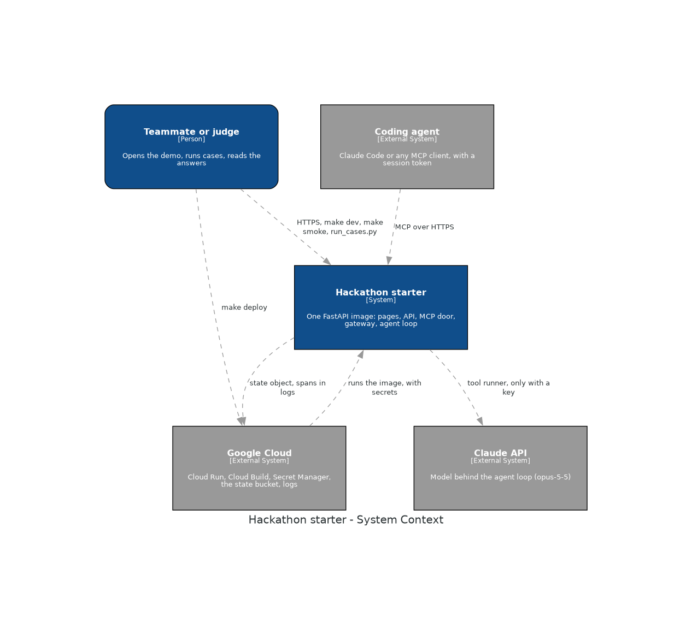
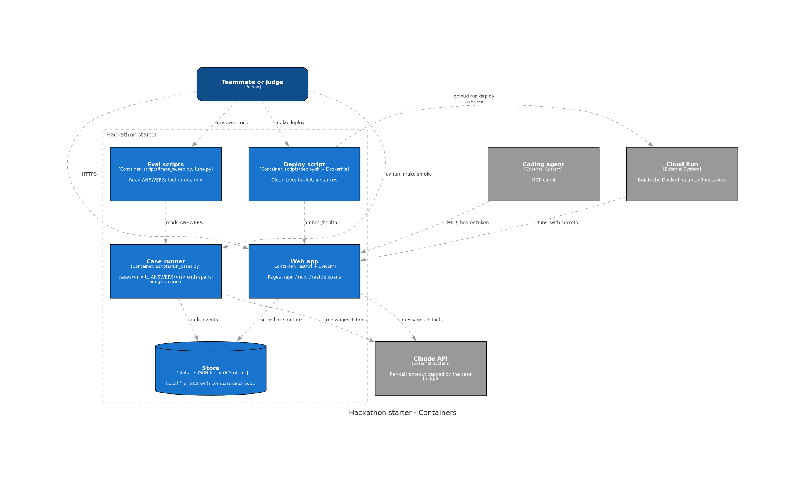
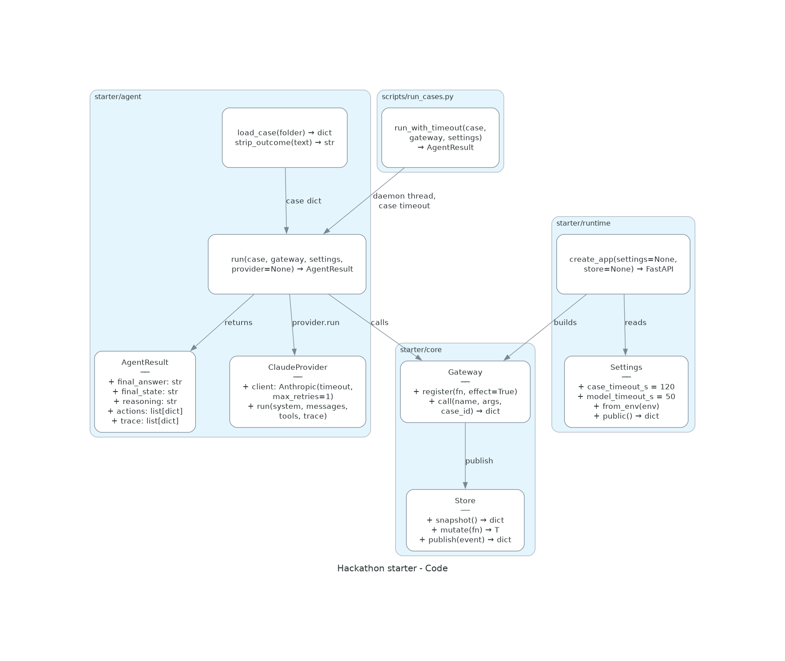

# hackathon-starter

One FastAPI image with one store, one tool gateway and one agent loop. Copy it into an event repo
as the first commit, then build verticals on it.

## Run

```bash
uv sync
make dev            # http://127.0.0.1:8000, offline, seeded; no keys needed
```

The runs page is `/`; health is `/health` (`/healthz` also works locally); log in with `POST /api/login {"password": "admin"}`
(local default) and send the token as `Authorization: Bearer <token>`.

With `ANTHROPIC_API_KEY` set, the agent uses Claude (`MODEL`, default `claude-opus-5-5`). Without
it, `FakeProvider` takes one simulated action and says so in every answer.

A tool with an external effect never acts unless `EFFECTS=live`. By default, locally and in the
cloud, the gateway checks its arguments and answers `SIMULATED` without running it; `/health`
shows `"effects"`.

Each case has a budget: `CASE_TIMEOUT_S` (default 120 s), at most `MAX_ITERATIONS` model calls
(default 8) at `EFFORT` (default `medium`). When the budget runs out, or the runner gives up on
the case, no further tool runs, nothing more is written, and the case ends `ERROR` with "case
budget exhausted".

## Check

```bash
make check          # ruff + pytest, offline
make smoke          # check, then the sample cases offline with any key forced off: the merge gate
make eval           # the sample cases on the real model (needs ANTHROPIC_API_KEY); never a gate
```

## Run cases

```bash
uv run scripts/run_cases.py cases/sample    # writes ANSWERS/<n>/{ANSWER.md, REASONING.md, trace.jsonl, spans.jsonl}
```

A case is a folder with `index.md` and optionally `history.md`. Any `## Outcome` section is cut
before the model sees the case. Each `ANSWER.md` has a `Final state:` line (DONE, NEEDS_INFO,
ESCALATED or ERROR); each `trace.jsonl` line has `tool`, `status` and `error`, so
`grep '"status": "ERROR"' ANSWERS/*/trace.jsonl` lists every failed tool call. One case in five is a holdout (`starter/eval/holdout.py`; sample
case `004` is one): never tune on it.

`spans.jsonl` holds the case's OpenTelemetry spans (`case`, `model`, one `gateway.call` per tool
call), secrets redacted; its `trace_id` is the one in `trace.jsonl`. The server prints the same span
lines for every request to stdout, and each request log line carries its `trace_id`.

## MCP door

The gateway's tools are also an MCP server at `/mcp` (Streamable HTTP), so Claude Code or any MCP
client can call them. Every call goes through the gateway: it is validated, simulated unless
`EFFECTS=live`, and logged with case id `mcp-<session>`.

```bash
make dev                      # one terminal
make mcp                      # prints the claude mcp add line for http://127.0.0.1:8000/mcp
ADMIN_PASSWORD=<admin password> make mcp MCP_URL=<service url>/mcp    # a deployed service
```

Each `make mcp` mints a new session token; `POST /api/mcp/token` with the admin token does the same.

## System rules

- **One factory.** Every app, router and page is mounted by `create_app()` in `starter/runtime/factory.py`.
- **One store.** All state goes through `starter/core/store.py` (`snapshot`, `mutate`, `publish`).
- **One gateway.** Every tool call and external effect goes through `starter/core/gateway.py`.
- **No simulated success outside the gateway.** Only it may simulate an effect, marked `SIMULATED`.
- **`make dev` runs every part**, offline with no keys; a new part joins it in the same change.
- **Current docs.** Read a library's current docs before using its API.
- **Files stay under 1,000 lines** (`tests/test_file_sizes.py`). Split before you cross it.
- **Run `make check` before `DONE:`.**

In an event repo these rules live in the kit's AGENTS.md §1.

## Add a vertical

Copy `starter/verticals/example.py`. Export a `router`; optionally `seed(store)` for local data and
`register_tools(gateway)` for agent tools. The factory and the gateway pick it up; nothing else
changes. Follow the system rules above.

## Deploy

```bash
make deploy PROJECT=<gcp-project-id>        # from a clean, committed main
```

Builds the Dockerfile on Cloud Build, deploys to Cloud Run with the commit as a label, prints the
URL and checks `/health`. One-time setup and rollback: `docs/deploy.md`.

## Provider checklist (the night before)

- [ ] `ANTHROPIC_API_KEY` works: `uv run scripts/run_cases.py cases/sample` writes answers whose
      `trace.jsonl` first line says `"provider": "claude"`.
- [ ] The model in `MODEL` (default `claude-opus-5-5`) answers on this key.
- [ ] GCP project with billing; `gcloud auth login` done; APIs enabled and both secrets created
      (`docs/deploy.md`).
- [ ] `make deploy PROJECT=<id>` prints a URL whose `/health` says `"anthropic": "configured"`.
- [ ] The admin password secret is set and shared with the team out of band.
- [ ] Each event-specific provider (email, voice, browser, analytics) has its own line here.

## Pre-existing work

This repository starts from `hackathon-starter`, a private template prepared before the event: an
app factory, a JSON store, a tool gateway, an agent loop with an offline stand-in, a case runner and
a deploy script. It contains no event-specific logic, data or prompts. Everything after the first
commit, "chore: pre-existing starter from hackathon-starter@<sha>", was built during the event.
Check the event's rules on pre-existing code before publishing, and extend this paragraph if they
ask for more.

## Architecture

Drawn from the code by `docs/architecture/c4.py`; redraw with `uv run docs/architecture/c4.py`
after changing a box or an arrow.

**Context:** who uses the starter and what it depends on.



**Containers:** the web app and the case runner share one store and one model.



**Components:** inside the web app, every tool call goes through the gateway.


**Code:** the signatures the rest of the code depends on.


