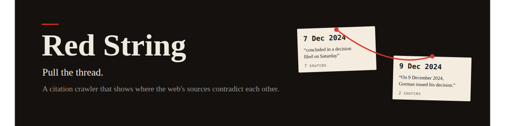
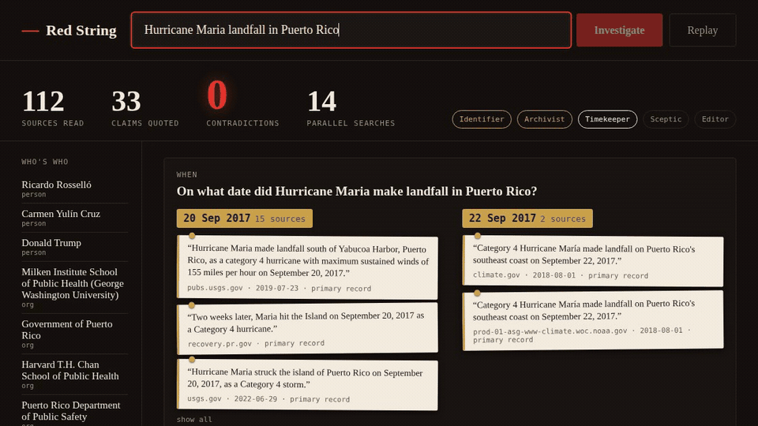
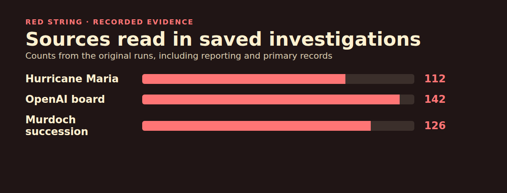
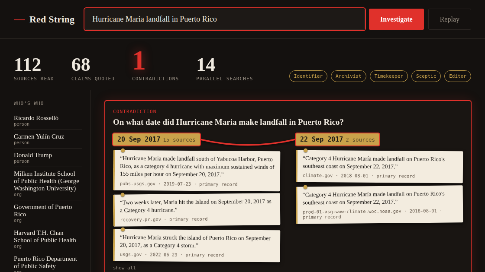
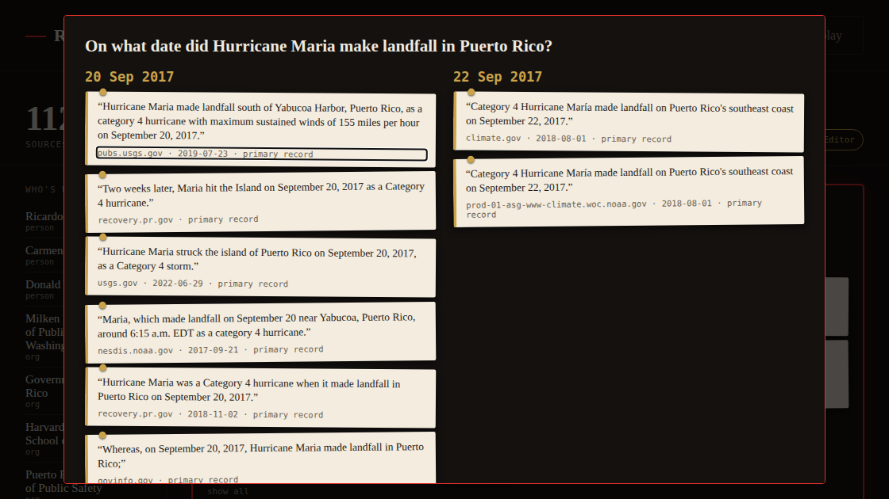
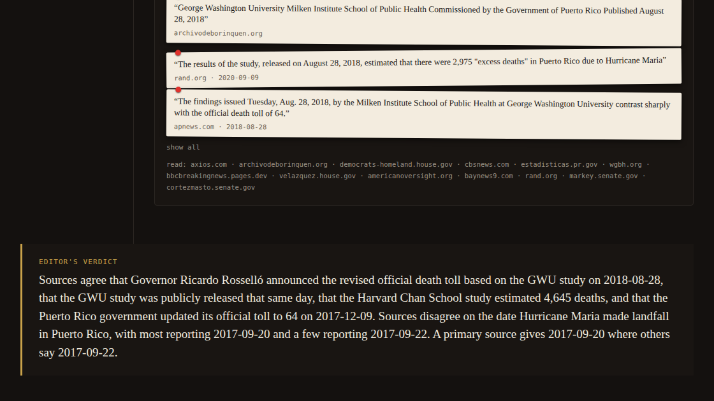

# Red String

[](pyproject.toml)
[](Makefile)
[](#installation)

Investigative reporters have to reconcile dates and amounts across dozens of sources, often with browser tabs, spreadsheets and manual comparisons. In the saved Hurricane Maria investigation, the collector read **112 sources** before surfacing one disagreement about the landfall date. [Saved run](cases/runs/maria.json)

Red String turns a reporting premise into checkable questions. It pins literal quotes beside the values they support and draws a red string wherever sources disagree on the same fact. A gold marker identifies a source categorized as a primary record, so reporters can examine it alongside the press.

Built in two hours at the Agentic Web build night, Parallel × No Agenda, London, on 11 November 2026. The project won £250,000 in credits. Red String reads search excerpts and reports the disagreement it sees. Its primary-record marker is based on domain, and the reporter decides what the quotes establish.

**[Run the interactive replay](#installation)** · **[Watch the Hurricane Maria walkthrough](docs/assets/replay.mp4)**



<sub>A recording of the app's flat evidence wall replaying a saved Parallel run. The evidence and quotes are the recorded investigation's.</sub>

## How it works

1. **Turn a premise into checkable questions.** Parallel Responses identifies people and organizations and returns questions with a checkable date or amount. Parallel Search looks for reporting and primary records concurrently (`starter/parallel.py`, `starter/investigate.py`).

   

2. **Build the wall from quoted evidence.** For each question, the crawler checks that a quote is in the source excerpt and that it contains the date or number claimed. Distinct answers get separate groups, and a candidate disagreement is checked twice to see whether the quotes are talking about the same fact at the same time (`starter/investigate.py`).

   

3. **Open the evidence and decide.** The detail panel puts the literal quotes and their source links side by side. The verdict summarizes where the sources agree and where the primary record differs (`starter/web/static/wall.html`, `starter/web/static/world.html`).

   

## Results



These are counts from the saved runs. Opposing values had to pass checks against literal excerpts before a disagreement reached the wall. The Hurricane Maria replay shows the 20 and 22 September claims side by side.

| Saved investigation | Sources read | Claims quoted | Contradictions |
| --- | ---: | ---: | ---: |
| [Hurricane Maria](cases/runs/maria.json) | **MEASURED** · 112 | **MEASURED** · 68 | **MEASURED** · 1 |
| [OpenAI board](cases/runs/openai.json) | **MEASURED** · 142 | **MEASURED** · 62 | **MEASURED** · 0 |
| [Murdoch succession](cases/runs/murdoch.json) | **MEASURED** · 126 | **MEASURED** · 93 | **MEASURED** · 0 |

| Evidence wall | Literal quotes | Editor verdict |
| --- | --- | --- |
|  |  |  |

## Installation

You need Git and [uv](https://docs.astral.sh/uv/). The saved replays work without an API key.

```sh
git clone https://github.com/atiladeokegab/red-string.git
cd red-string
uv sync                                           # Install pinned dependencies
uv run uvicorn starter.main:app --port 8000        # Start the local app
make check                                        # Optional, run lint and offline tests
```

Open [Hurricane Maria](http://localhost:8000/static/world.html?replay=maria), [OpenAI board](http://localhost:8000/static/world.html?replay=openai) or [Murdoch succession](http://localhost:8000/static/world.html?replay=murdoch). Export `PARALLEL_API_KEY` before starting the server to investigate a new story.

## Documentation

[Architecture context](docs/architecture/c4_context.png) · [Containers](docs/architecture/c4_container.png) · [Components](docs/architecture/c4_component.png) · [Saved runs](cases/runs/).

## Contact

Open an [issue](https://github.com/atiladeokegab/red-string/issues) with the premise and a source link when reporting a discrepancy. Atilade Oke ([GitHub](https://github.com/atiladeokegab), [LinkedIn](https://www.linkedin.com/in/atiladeoke/)).

## Contributing

Run `make check` and check a saved replay before opening a pull request. For a claim-handling change, include the relevant excerpt and expected behavior in the test.

## Citation

```bibtex
@software{red_string_2026,
  title = {Red String},
  year = {2026},
  url = {https://github.com/atiladeokegab/red-string}
}
```

## License

Contact the maintainers for terms on the project code. The reporting and excerpts retain their original sources, linked from each quote on the wall.
