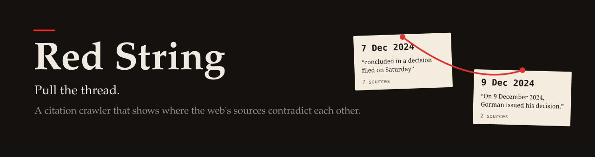
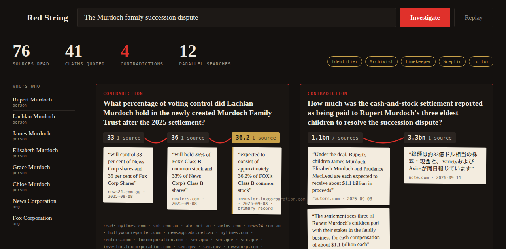
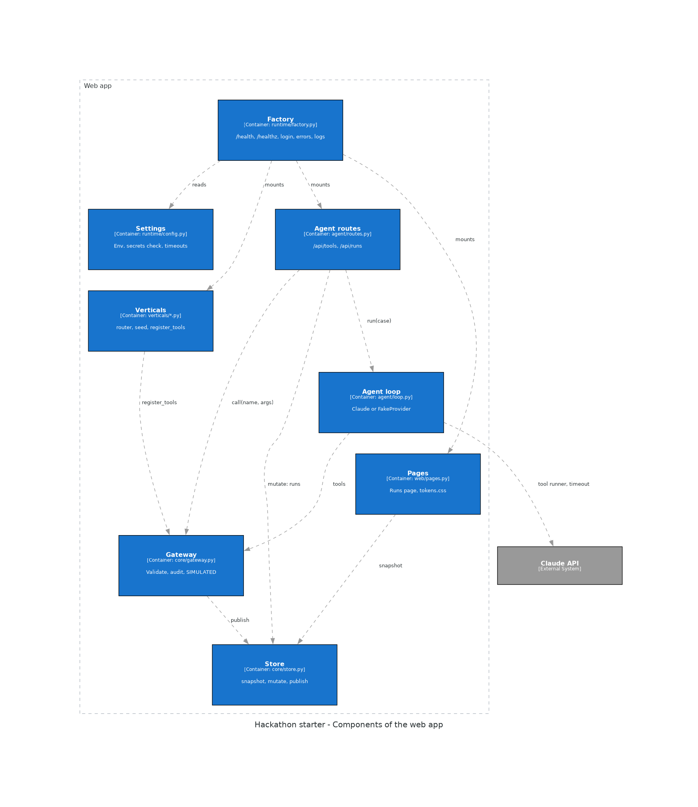

<p align="center">
  
</p>

<p align="center"><b>Type a story. Watch a hundred sources get pinned to the wall, and a red string snap between every
two that contradict each other.</b></p>

<p align="center"></p>

Red String is a citation crawler for journalists. You give it an investigative premise. It works out
who is in the story, reads the web's reporting on it, quotes what each source says about the
checkable facts (when did it happen, how much was it), and shows you where the sources disagree,
with the primary record (court, regulator, filing) marked in gold beside the press.

Built in two hours at the Agentic Web build night (Parallel x No Agenda, London, 11 Nov 2026).

## What you see

1. **One box, one button.** Type a premise, press Investigate.
2. **Who's who.** The people and organisations in the story appear first.
3. **The wall fills.** Each checkable question gets a panel. Every source is pinned under the
   answer it gives, with its exact quote and a link.
4. **Red string.** Where sources give different dates or amounts, a red string joins the
   disagreeing answers. Click it to read the quotes side by side.
5. **The verdict.** A short editor's note: what the sources agree on, where they differ, and what
   the primary record says.

Every quote is checked to be a real substring of the text the source returned, and the date or
number taken from it must be stated in that quote. A claim that fails either check is dropped, not shown. The tool reports what sources say; it makes no
claims of its own.

## How it uses Parallel

| Step | Parallel API | What it does |
|---|---|---|
| Identify the people and the checkable questions | Responses (`/v1/responses`) | One web-grounded answer, returned as JSON |
| Read the reporting | Search (`/v1/search`) | Two searches per question (the reporting, then primary records), run concurrently, up to 15 sources each |
| Quote what each source says | Responses | Batched calls per question over that question's excerpts, answers held to a JSON schema |
| Find the contradictions | none, then Responses | Plain code finds more than one distinct date or number for the same question; each candidate is then checked twice to confirm the quotes describe the same fact at the same moment, or it is dropped |

The counter at the top of the page shows the real number of Parallel searches and sources read in
the run on screen.

## How it works

**Context:** who uses it and what it depends on.


**Containers:** the page, the event stream, the engine and the Parallel client.


**Components:** the engine's steps and the event each one emits.



## Run it

```bash
uv sync
echo "PARALLEL_API_KEY=your-key" > .env      # from platform.parallel.ai
set -a; . ./.env; set +a
uv run uvicorn starter.main:app --port 8000
# open http://localhost:8000/static/world.html
```

**Replay** plays back a saved real run with no network, for when the venue Wi-Fi does not cooperate.
`?replay=maria` plays Hurricane Maria (112 sources, 68 claims, 1 contradiction: a NOAA page dates landfall 22 September against 20 September everywhere else), `?replay=openai` the OpenAI board run (142 sources, 62 claims, sources agree), or
`?replay=murdoch` for the Murdoch succession dispute (126 sources, 93 claims, where the sources agree and no red string is drawn).

The page is a 3D world: every answer is a tower whose height is the number of sources that state it,
contradicting answers turn red and are joined by a red string, and five block investigators
(Identifier, Archivist, Timekeeper, Sceptic, Editor) run to whatever they are working on. Drag to look
around, click a red tower to read the quotes side by side. The earlier flat evidence wall is still at
`/static/wall.html`.

`make check` runs the lint and the offline tests.

## Pre-existing work

The FastAPI app factory, store, agent loop and deploy scripts under `starter/` come from a starter
kit written before the event. Written at the event: `starter/parallel.py`,
`starter/investigate.py`, `starter/web/static/wall.html`, their tests, and this README.

## Known limits

- "Primary record" is a domain rule (courts, government, regulators, filings, archives), not a
  judgement about the document.
- It reads the excerpts Parallel's search returns (up to 2,000 characters per source per question), not
  every full page.
- A contradiction means two sources state different values. Some are real disagreements; some are the
  same fact at different moments (a head count that grew through the day). The quotes are side by side
  so the reader can tell which.
- A relative date in a quote ("filed on Saturday") is resolved against the article's publish date.
- Parallel's Monitor API (re-check the story on a schedule and push new contradictions) is wired in
  the client but not used by the page yet.
